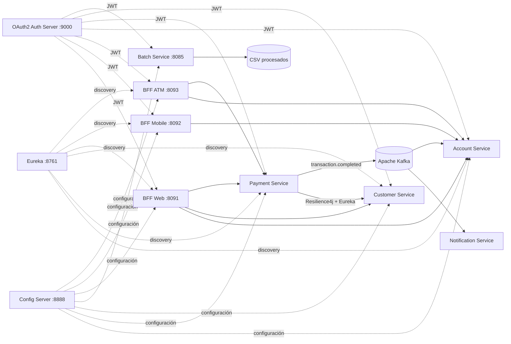

# Banco XYZ - Evaluación Final Transversal Backend III

# Repositorio GitHub

https://github.com/iKriman/backend_iii

Proyecto de modernización del sistema legacy del Banco XYZ hacia una arquitectura de microservicios con Spring Boot, Spring Cloud, Spring Batch, OAuth2, Resilience4j, Apache Kafka y Docker Compose.

## Objetivo

La solución reemplaza procesos legacy basados en COBOL/Shell por servicios desacoplados, escalables y seguros. Se implementan tres procesos batch, tres microservicios de negocio, tres BFF independientes por canal, configuración centralizada, descubrimiento de servicios, autenticación/autorización distribuida, resiliencia y mensajería asíncrona.

## Arquitectura



## Componentes

| Componente | Responsabilidad | Puerto host |
|---|---|---:|
| `config-server` | Spring Cloud Config | 8888 |
| `discovery-server` | Eureka Service Discovery | 8761 |
| `auth-server` | OAuth2 Authorization Server / JWT | 9000 |
| `batch-service` | 3 jobs Spring Batch sobre datos legacy | 8085 |
| `account-service` | Apertura, cierre, consulta y saldo de cuentas | interno |
| `payment-service` | Pagos, transferencias, depósitos y retiros | interno |
| `customer-service` | Gestión de clientes y perfiles | interno |
| `bff-web` | Respuesta completa para navegador | 8091 |
| `bff-mobile` | Respuesta reducida para móvil | 8092 |
| `bff-atm` | Operaciones críticas para cajero | 8093 |
| `notification-service` | Consumidor Kafka de eventos | 8084 |
| `kafka` | Mensajería asíncrona | interno |

## Procesos Spring Batch

1. **Reporte de transacciones diarias**: procesa `movimientos_financieros_diarios.csv`, valida fecha/monto/tipo, omite filas inválidas y genera `output/reporte_transacciones_diarias.csv`.
2. **Cálculo de intereses mensuales**: procesa `intereses_trimestrales.csv`, valida cuenta/saldo/edad/tipo y genera `output/calculo_intereses_mensuales.csv`.
3. **Estados de cuenta anuales**: procesa `estados_financieros_anuales.csv`, valida movimientos y genera `output/estados_cuenta_anuales.csv`.

Los steps usan procesamiento por chunks, `skip` para registros inválidos y `retry` para fallos temporales de infraestructura. El job de transacciones incorpora `TaskExecutor` para paralelismo y el tamaño de chunk permite escalar el procesamiento de grandes volúmenes.

## Seguridad

- OAuth2 `client_credentials`.
- JWT firmados por `auth-server`.
- `bank-api-client`: `bank.read`, `bank.write`, `batch.execute`, `events.read`, `events.write`.
- `bank-atm-client`: `atm.read`, `atm.write`.
- Cada BFF y microservicio aplica autorización por scope.
- Los BFF propagan el token Bearer hacia los microservicios internos.

## Resiliencia

`payment-service` consulta el nivel de riesgo de `customer-service` mediante Eureka + LoadBalancer. La llamada está protegida por **Circuit Breaker** y **Retry** de Resilience4j, con fallback `UNKNOWN` cuando el servicio externo no está disponible.

## Mensajería asíncrona

`payment-service` publica eventos `bank.transactions.completed` en Apache Kafka. `account-service` consume esos eventos para actualizar saldos y `notification-service` los consume para registrar notificaciones. La separación permite procesamiento asíncrono y desacoplado.

## Docker y escalabilidad horizontal

La plataforma se ejecuta con `docker-compose.yaml`. Los tres microservicios de negocio no fijan puertos al host, por lo que pueden escalar horizontalmente, por ejemplo:

```bash
docker compose up -d --scale account-service=2 --scale payment-service=2 --scale customer-service=2
```

Cada réplica se registra en Eureka y los clientes usan resolución por nombre de servicio.

## Documentación incluida

- `readme.md`: resumen técnico y código fuente.
- `instrucciones.md`: ejecución y pruebas paso a paso.
- `despliegue.md`: despliegue local y propuesta AWS.
- `MATRIZ_CUMPLIMIENTO.md`: trazabilidad contra la pauta de evaluación.
- `docs/`: evidencias y material de apoyo.
